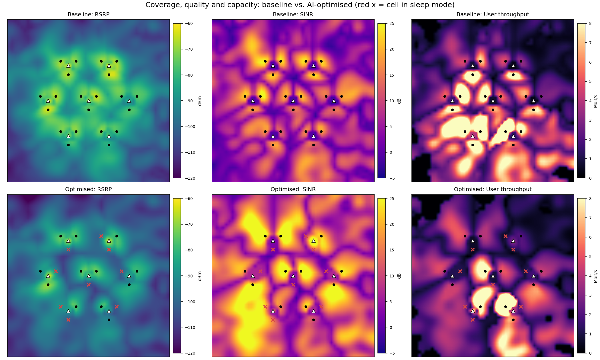
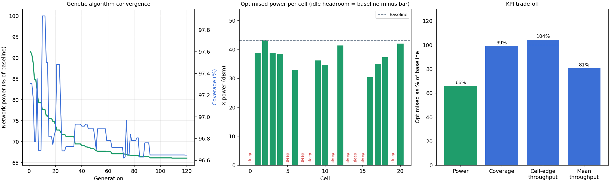

# RAN Power Optimizer

**English** | [Türkçe](README.tr.md)

### 🚀 [Live demo: try it in your browser](https://ran-power-optimizer.streamlit.app)

No installation needed. Press **Run optimisation** and change the scenario and QoS limits in the sidebar.
(The app may need a few seconds to wake up if nobody has used it recently.)

AI-driven energy saving for a mobile radio access network (LTE/5G macro layer).
A genetic algorithm tunes **transmit power, electrical downtilt and cell sleep mode**
for every sector so the network uses less energy while coverage and user throughput
stay within defined limits.

> All data is **synthetic**. No operator data, tools or measurements are used.




## What it does

1. **Builds a network**: hexagonal grid of 3-sector macro sites, correlated shadowing
   and traffic hotspots.
2. **Evaluates a configuration**: RSRP, SINR, serving cell, per-user throughput and
   total input power for every grid point.
3. **Optimises**: a genetic algorithm minimises network power subject to limits on
   coverage loss, cell-edge throughput loss and mean throughput loss, followed by a
   greedy per-cell power refinement.
4. **Reports**: before/after maps, convergence plot, per-cell CSV, KPI JSON and a
   Streamlit dashboard.

## Quick start

```bash
pip install -r requirements.txt
python main.py                  # 7 sites / 21 cells, results in results/
python main.py --rings 2        # 19 sites / 57 cells
streamlit run app.py            # interactive dashboard
python -m pytest                # tests
```

Options: `--max-cov-drop`, `--max-edge-drop`, `--max-mean-drop`, `--pop`, `--gens`,
`--seed`, `--hotspots`.

## Model

| Part | Approach |
|---|---|
| Path loss | Simplified 3GPP TR 38.901 UMa, LOS-probability weighted, 2.1 GHz, 25 m sites |
| Shadowing | Gaussian random field, 5 dB std, 80 m correlation distance |
| Antenna | 3GPP sector pattern (65 deg horizontal) plus vertical pattern around the electrical tilt |
| RSRP | Per-resource-element power (1200 subcarriers) + antenna gain - path loss |
| SINR | Serving RSRP over load-weighted neighbour interference plus thermal noise |
| Throughput | Truncated Shannon, bandwidth shared by the users of a cell |
| Energy | EARTH-style linear model: static power + slope x RF output, reduced power in sleep mode |
| Optimiser | Genetic algorithm (tournament selection, uniform crossover, elitism) + greedy refinement |

Coverage means RSRP >= -110 dBm and SINR >= -3 dB.

## Outputs

- `results/coverage_comparison.png`: RSRP, SINR and throughput maps, baseline vs. optimised
- `results/optimization_summary.png`: convergence, power per cell, KPI trade-off
- `results/cell_report.csv`: per-cell settings, users and power before/after
- `results/summary.json`: network-level KPIs

## Limitations

- Static snapshot: no mobility, handover or time-varying traffic.
- Simplified propagation and an illustrative energy model.
- Border cells have fewer neighbours (edge effects).

## Ideas for extension

- Reinforcement learning for day/night traffic profiles
- Multi-objective optimisation (Pareto front of energy vs. QoS)
- Placement of mobile communication nodes in tactical or disaster scenarios

## References

- 3GPP TR 38.901, Study on channel model for frequencies from 0.5 to 100 GHz
- G. Auer et al., "How much energy is needed to run a wireless network?", IEEE Wireless Communications, 2011
